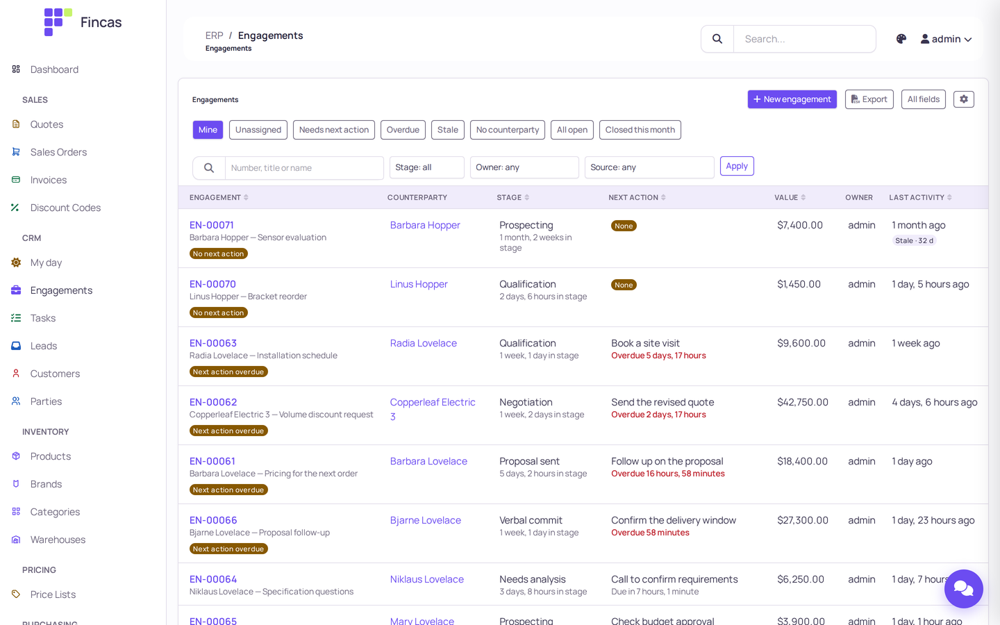
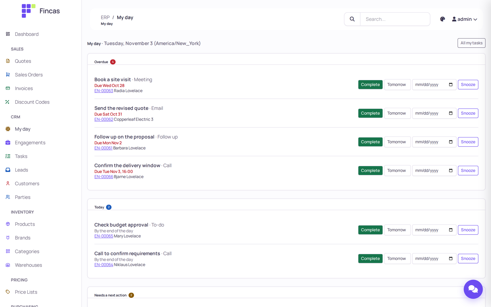
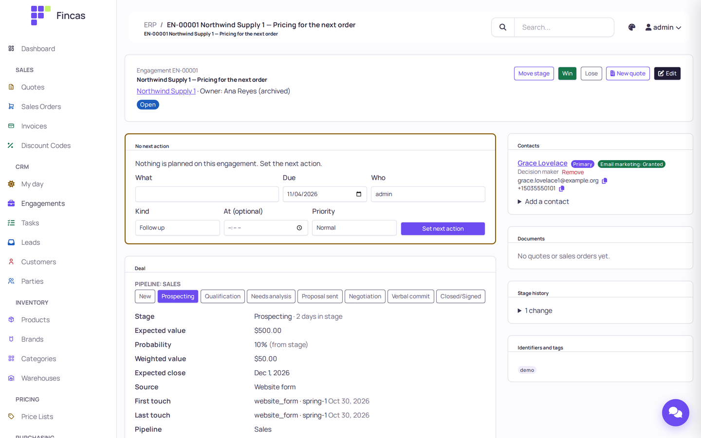
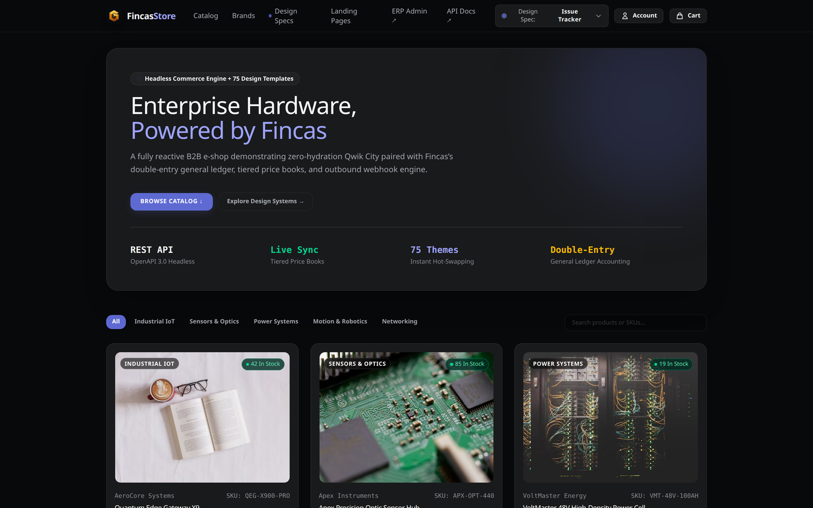

# Fincas

[](https://github.com/Logos-Flux/fincas/actions/workflows/ci.yml)
[](https://pypi.org/project/fincas/)
[](https://www.python.org/)
[](https://www.djangoproject.com/)
[](LICENSE)

Fincas is an open-source ERP **and a headless Qwik storefront that runs on
it**, in one repository. The back office (Django) holds quotes and orders,
invoicing and a double-entry ledger, inventory and purchasing, and a CRM; the
storefront (Qwik City) reads that same data live through the REST API and
places orders into it. There is no product feed, no sync job and no second
database to reconcile. You install the ERP as a Python package and run it as
your own Django project, extended with plugins instead of forks.

**Try it:** the live demo runs the current release. Back office at
[demo.fincas.dev](https://demo.fincas.dev/erp/) (sign in as `demo` /
`golden-demo`), storefront at [shop.demo.fincas.dev](https://shop.demo.fincas.dev/),
both on the same ERP. The demo is shared and its data is reset from time to time.

**Status:** actively maintained, beta. One company per instance. Python 3.12,
PostgreSQL 17, Django 6.0.

> **Import name:** the PyPI distribution is `fincas`, but the Python package is
> `golden_erp` (the project's earlier name), and settings keep the `GOLDEN_*`
> prefix. You write `pip install fincas`, then
> `from golden_erp.settings.prod import *` and `include("golden_erp.urls")`.
> Both names stay as they are so existing deployments and plugins keep working.



<table>
  <tr>
    <td width="33%"><a href="https://raw.githubusercontent.com/Logos-Flux/fincas/main/docs/images/screenshots/crm-my-day.png"></a><br><sub>My day: what is overdue and due today</sub></td>
    <td width="33%"><a href="https://raw.githubusercontent.com/Logos-Flux/fincas/main/docs/images/screenshots/crm-engagement.png"></a><br><sub>An engagement: next action, deal, contacts</sub></td>
    <td width="33%"><a href="https://raw.githubusercontent.com/Logos-Flux/fincas/main/docs/images/screenshots/storefront.png"></a><br><sub>The example storefront on the Fincas API</sub></td>
  </tr>
</table>

<sub>Back office: a local install with `make seed` demo data. Storefront: its built-in demo catalog.</sub>

## One ERP, one storefront, one source of truth

Most shops run an ERP and a storefront as two systems and spend their time
keeping them in step. In Fincas the storefront has no catalog of its own: it
is a [Qwik City](https://qwik.dev/) app in [`storefront/`](storefront/) that
asks the ERP for everything, on every request.

- **The catalog is the ERP's catalog.** Products, variants, categories,
  brands, prices with quantity breaks, stock levels and SEO titles and
  descriptions come straight from the API. Edit a product in the back office
  and the storefront shows it on the next page load.
- **Checkout lands in the back office.** A guest checkout creates a real sales
  order with an ERP order number, ready for staff in the order list.
- **Customer accounts read the ERP.** Signed-in customers see their profile,
  their orders and each order's detail through the customer portal API, from
  the same records your staff work with.
- **Nothing secret ships to the browser.** The storefront holds no API key. A
  visitor's browser gets a short-lived, least-privilege token that can read
  the catalog and public prices and create a guest order, and nothing else
  ([the storefront contract](docs/architecture.md#4-the-storefront-contract)).
- **Fast and themeable.** Qwik resumes instead of hydrating, so pages ship
  almost no JavaScript up front. 75 themes switch at runtime, landing-page
  templates are included, and Playwright journeys with axe accessibility
  checks run in CI.
- **Headless means replaceable.** Every endpoint is described by the OpenAPI 3
  schema. Use the included storefront as it is, restyle it, or build your own
  on the same contract.

Run both locally: `make run` for the ERP, then `make storefront-install` and
`make storefront-dev` (it talks to `http://localhost:8000/api`).

**Current limit:** a guest order arrives with the buyer's details and the
order header; its cart lines are not yet copied onto the order, so staff add
them in the back office. Copying the lines is the next storefront milestone.

## Install

### From PyPI (to run Fincas)

```bash
python3.12 -m venv .venv && . .venv/bin/activate
pip install "fincas[prod]"
```

Fincas is a library: your deployment is a small Django project with a
`config/settings.py` that starts from `golden_erp.settings.prod` and a
`config/urls.py` that mounts `golden_erp.urls`.
[docs/getting-started.md](docs/getting-started.md) takes you from an empty
directory to a first login; [docs/packaging.md](docs/packaging.md) covers the
settings overlay and version pinning.

WeasyPrint renders the PDFs and needs Cairo and Pango from your OS
(`libpango-1.0-0 libpangocairo-1.0-0 libcairo2` on Debian and Ubuntu).

### From source (to work on Fincas)

```bash
git clone https://github.com/Logos-Flux/fincas.git
cd fincas
python3.12 -m venv .venv && . .venv/bin/activate
pip install -r requirements/dev.txt
make migrate          # SQLite in the working directory
make seed             # demo company, catalog, customers, chart of accounts
make run              # http://localhost:8000/erp/
```

`make seed` creates the superuser `admin` with the password `admin`. That is
for a local machine only; pass `--admin-password` to `manage.py seed_demo_data`
anywhere else. The API docs are at `http://localhost:8000/api/docs/`.

[CONTRIBUTING.md](CONTRIBUTING.md) has the full development setup, including
Docker Compose and the storefront.

## What's in it

- **Sales:** quotes with revisions, sales orders with shipment groups and
  drop-ship lines, sales invoices, payments through pluggable gateways
  (Stripe and manual included), coupon codes, price lists with customer-tier
  breaks, tax rates.
- **Operations:** multi-warehouse stock, purchase orders and receiving, pick
  tickets, carrier rates and labels (EasyPost), PDF quotes, orders, invoices
  and purchase orders (WeasyPrint).
- **Accounting:** chart of accounts, fiscal periods, journal entries posted
  from documents by configurable rules, trial balance checks.
- **CRM:** one party record per person or organization (merge, undo, GDPR-style
  erasure), leads, pipelines and engagements with stage history, tasks,
  communications, custom fields, imports from another CRM's export, and
  adapters for Aircall, Gmail, ClickUp, Klaviyo and Google Ads.
- **Storefront and API:** a Qwik City storefront in `storefront/` that runs
  on the live ERP (see above), a REST API with an OpenAPI 3 schema (Swagger UI
  and Redoc included), a least-privilege storefront identity, and a customer
  portal.
- **Extending it:** plugins add navigation, dashboard widgets, payment
  gateways, carriers, CRM adapters, outbox consumers and URLs; HMAC-signed
  outbound webhooks; a label layer to rename nouns in the staff UI; generated,
  WCAG AA-checked back-office themes.
- **Assistant:** an optional AI chat drawer for staff, routed through
  `llmhub`: direct provider keys (Anthropic or any OpenAI-compatible endpoint)
  or your own gateway.

## One company per instance

Each Fincas instance serves one company: one database, one `core.Company` row,
one deployment. Another company gets its own instance. System check
`core.E070` refuses a second Company
([docs/deployment.md](docs/deployment.md#one-instance-per-company)).

## Plugins

Fincas is extended without editing core files. A plugin is a class listed in
`GOLDEN_PLUGINS`:

```python
# hello_fincas/plugin.py
from core.plugins import BasePlugin


class HelloPlugin(BasePlugin):
    name = "hello"
    verbose_name = "Hello, Fincas"
    version = "0.1.0"

    def get_nav_items(self):
        return [{
            "type": "link",
            "label": "Hello",
            "section": "analytics",
            "url_name": "erp-dashboard",
            "icon": "fas fa-chart-line",
        }]
```

```python
# config/settings.py
GOLDEN_PLUGINS = ["hello_fincas.plugin.HelloPlugin"]
```

[docs/plugins.md](docs/plugins.md) covers every hook, lifecycle signals, the
outbox, plugin URLs and testing a plugin.

## LLM features

Every LLM call goes through `llmhub` and is configured on the staff-only
`/erp/llm/` page or by environment: direct provider keys (`ANTHROPIC_API_KEY`,
or `OPENAI_BASE_URL` and `OPENAI_API_KEY` for any OpenAI-compatible endpoint),
or an OpenAI-compatible gateway (`LLMHUB_MODE=gateway`,
`LLMHUB_GATEWAY_BASE_URL`). `python manage.py llmhub_check` makes one small
test call per configured purpose (`--no-live` checks resolution only).

Set `LLMHUB_ALLOWED_BASE_URLS` in production. It is empty by default, and while
it is empty any staff user can point LLM traffic, including ERP data in
prompts, at a host of their choosing from the settings page.

## Documentation

The full index is [docs/README.md](docs/README.md). Start with:

- [Getting started](docs/getting-started.md): from `pip install` to a first login
- [Architecture](docs/architecture.md): the apps, the plugin seam, the storefront contract
- [Deployment](docs/deployment.md): Docker Compose, systemd and Fly.io, required secrets
- [Upgrading](docs/upgrading.md): versioning, deprecations and the migration contract
- [Plugins](docs/plugins.md) and [Webhooks](docs/webhooks.md)
- [Changelog](CHANGELOG.md)

## Contributing and security

Bug reports, fixes and documentation are welcome: see
[CONTRIBUTING.md](CONTRIBUTING.md) and the [code of conduct](CODE_OF_CONDUCT.md).
Report security issues privately, as described in [SECURITY.md](SECURITY.md),
not in a public issue.

## License

[MIT](LICENSE). Logo and brand assets: `fincas-grid-brand/`.
