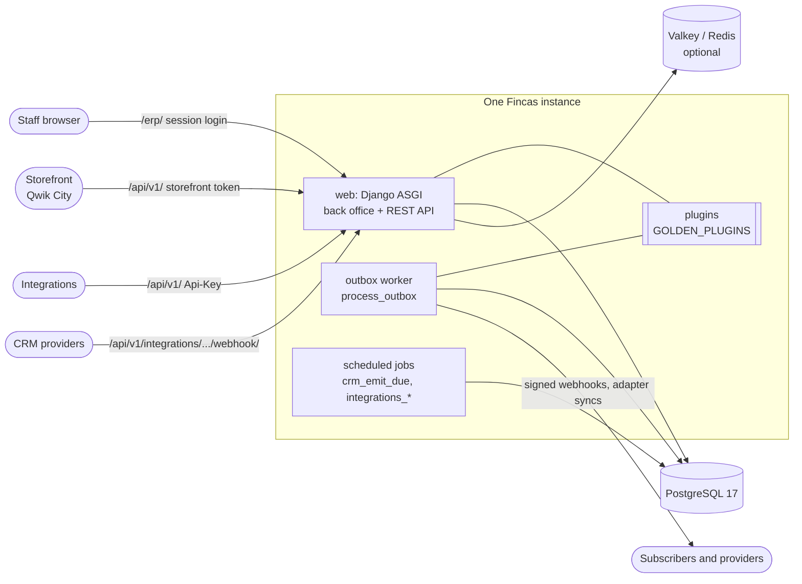

# Fincas architecture

Fincas is a Django 6 project packaged as a library: a set of Django apps plus a
`golden_erp` package that holds the base settings, URL patterns and the
project-level templates and static files. A deployment is a small Django
project of its own that installs the `fincas` wheel, starts its settings from
`golden_erp.settings.prod` and mounts `golden_erp.urls`
([packaging.md](packaging.md)).

It serves three audiences over one database:

- **Staff** use the server-rendered back office under `/erp/` (Django
  templates, Tabler/Bootstrap, a little JavaScript).
- **Integrations and the storefront** use the REST API under `/api/v1/`
  (Django REST Framework, OpenAPI schema at `/api/schema/`, Swagger UI at
  `/api/docs/`, Redoc at `/api/redoc/`).
- **Customers** use the storefront (`storefront/`, a separate Qwik City app
  that talks only to the API) and the customer portal endpoints under
  `/api/v1/portal/`.

One instance serves **one company** (`core.Company`); see
[deployment.md](deployment.md#one-instance-per-company).

---

## 1. App map

Every app is a top-level Python package in the wheel, listed in
`INSTALLED_APPS` by `golden_erp/settings/base.py`.

### Foundation

| App | What it owns | Main models |
| :--- | :--- | :--- |
| `core` | the instance's company, staff profiles and roles, audit log, document numbering, API keys and service accounts, the outbox, the plugin engine, connected integration accounts, the label layer | `Company`, `UserProfile`, `Team`, `AuditLog`, `DocumentSequence`, `ApiKey`, `OutboxEvent`, `ExternalRef` |
| `parties` | one record per person or organization, with emails, phones, addresses, relationships, consent, merge and erasure | `Party`, `PartyRole`, `PartyRelationship`, `PartyEmail`, `ConsentRecord`, `PartyMergeLog` |
| `webhooks` | outbound event subscriptions, HMAC-signed delivery through the outbox | `WebhookSubscription`, `WebhookDeliveryLog` |

### Commerce

| App | What it owns | Main models |
| :--- | :--- | :--- |
| `products` | catalog: products, variants and options, brands, categories, images, supplier products | `Product`, `ProductVariant`, `Brand`, `Category` |
| `pricing` | price lists, customer-tier price breaks, tax rates | `PriceList`, `PriceListItem`, `TaxRate` |
| `customers` | customer accounts, contacts and addresses (each mirrored to a `Party`) | `Customer`, `CustomerContact`, `CustomerAddress` |
| `orders` | quotes, sales orders, sub-orders, shipment groups, sales invoices, the people on a document | `Quote`, `Order`, `SubOrder`, `ShipmentGroup`, `SalesInvoice` |
| `payments` | payments and pluggable gateway adapters | `Payment` |
| `discounts` | coupon codes and their usage | `DiscountCode`, `DiscountCodeUsage` |
| `purchasing` | suppliers, purchase orders, receipts | `Supplier`, `PurchaseOrder`, `POReceipt` |
| `inventory` | warehouses and stock levels | `Warehouse`, `WarehouseStock` |
| `fulfillment` | pick tickets and carrier adapters | `PickTicket`, `PickTicketLine` |
| `accounting` | double-entry ledger: chart of accounts, fiscal periods, journal entries, posting rules | `Account`, `FiscalPeriod`, `JournalEntry`, `DocumentPostingRule` |
| `documents` | PDF rendering (WeasyPrint) for quotes, orders, invoices and purchase orders | `ProductDocument` |
| `portal` | customer self-service endpoints (orders, quotes, addresses) | none of its own |

### CRM

| App | What it owns | Main models |
| :--- | :--- | :--- |
| `crm` | leads, pipelines and stages, engagements (deals) with stage history, tasks | `Lead`, `Pipeline`, `Stage`, `Engagement`, `EngagementStageChange`, `Task` |
| `communications` | every email, call, meeting or note, linked to parties and engagements; document-email logs | `Communication`, `CommunicationParticipant`, `EmailLog` |
| `crm_import` | resumable, undoable imports from another CRM's export ([crm/importing.md](crm/importing.md)) | `ImportJob`, `ImportJobBatch`, `ImportWriteLog` |
| `unify` | staged rows, column mapping and approval for CSV imports | `ImportBatch`, `StagedRow`, `ApprovalRun` |

### Content, reporting and assistants

| App | What it owns | Main models |
| :--- | :--- | :--- |
| `content` | articles for the storefront and knowledge base | `Article` |
| `reporting` | operational and CRM reports, CSV exports | `ReportDefinition` |
| `chat` | the back-office AI assistant drawer | `ChatSession`, `ChatMessage` |
| `llmhub` | routing of every LLM call by *purpose*: direct provider keys or an OpenAI-compatible gateway, managed on `/erp/llm/` | `LLMSettings`, `LLMModel` |

The wheel also ships `erp_assist` (an MCP adapter that exposes ERP operations
as tools over the REST API; not an installed Django app) and `addons` (the
bundled plugins: CRM adapters, see [crm/adapters.md](crm/adapters.md)).

### Cross-cutting rules

- **Every model has a UUID primary key with a default**, so `pk` is set before
  the first save. "Is this a create?" is `instance._state.adding`.
- **Records are company-scoped.** Transactional models carry a `company`
  foreign key, and querysets go through `.for_request(request)` /
  `scope_to_company(...)`. With one Company per instance this is a guard, not a
  feature.
- **Writes that matter go through services, not `save()` from views.**
  Engagement stage moves (`crm.engagements`), communications
  (`communications.ingest.record`), party merges (`parties.merge`) and erasure
  (`parties.erasure`) each write their own history rows.

---

## 2. Settings layers

| Module | Role |
| :--- | :--- |
| `golden_erp.settings.base` | everything a deployment shares: apps, middleware, DRF, the registries (`ERP_THEMES`, `ERP_NAV`, `GOLDEN_ROLES`, `GOLDEN_PLUGINS`, …). Sets no `DATABASES`. |
| `golden_erp.settings.prod` | base plus production hardening: `DATABASES` from `DATABASE_URL`, secure cookies, HSTS, the required-secrets check (`core.E060`), Mailgun, Sentry |
| your `config/settings.py` | starts from one of the above, adds `BASE_DIR`, `STATIC_ROOT`, `ROOT_URLCONF`, your plugins, and ends with `INSTALLED_APPS = compose_installed_apps(INSTALLED_APPS, GOLDEN_PLUGIN_APPS)` |

The repository's own `config/settings/{base,dev,test,prod}.py` are thin
layers over these for working on Fincas itself; they are not in the wheel.

Settings-driven registries validate when they are loaded and raise
`ImproperlyConfigured` (or fail a system check) on a bad entry rather than
dropping it silently.

---

## 3. The plugin seam

A plugin is a subclass of `core.plugins.base.BasePlugin`, listed by dotted
path in `GOLDEN_PLUGINS` (or discovered through the `golden_erp.plugins` entry
point). A plugin that also has models is a Django app, listed in
`GOLDEN_PLUGIN_APPS`. Full guide: [plugins.md](plugins.md).

What a plugin can contribute, each through one `get_*` hook:

- back-office navigation items, dashboard widgets and template extensions;
- payment gateways, shipping carriers and payroll providers;
- CRM adapters and CRM export adapters, communication kinds;
- outbox consumers (any work with network I/O);
- API token scopes and extra list columns;
- URLs, mounted after every core route (so a plugin can never shadow one) and
  staff-only unless the plugin declares `url_auth = "public"`.

Plugins also receive **lifecycle signals** (`core/plugins/signals.py`): order
placed, status changed or canceled, payment completed or refunded, shipment
dispatched or delivered, inventory adjusted, customer registered, party
created, updated, merged or erased, engagement created, moved, won, lost or
reopened, task created, assigned, completed or due, communication logged.
Signals are sent from model `save()` through `core.plugins.dispatch.emit`,
which defers them to `transaction.on_commit`, so a receiver never sees a
change that rolls back.

**The outbox** (`core/outbox/`) is how anything with I/O happens. A consumer's
`build` step runs inside the business transaction and writes an `OutboxEvent`
row; its `handle` step runs later in `manage.py process_outbox`, with no
transaction open; a failed attempt is retried, and a row that keeps failing ends up dead for an operator to requeue. Webhooks and every CRM adapter
use it. A receiver that calls a network service directly from a signal is a
bug.

---

## 4. The storefront contract

The storefront in `storefront/` is a separate Qwik City app. It holds **no API
key or secret**: everything it does goes through the public API as the
least-privilege `storefront-api` service identity (`core/storefront.py`).

1. The visitor's browser asks for a short-lived token at
   `POST /api/v1/core/auth/storefront-token/` (public, throttled). Issuance is
   on when `GOLDEN_STOREFRONT_TOKENS=True`.
2. With that bearer, the storefront may read the catalog and public prices
   (`products`, `pricing` view permissions) and create a guest order
   (`orders.add_order`, honored only on the order `create` action). Nothing
   else: it cannot read orders, customers, suppliers or invoices, and it is not
   staff.
3. A guest order is created from a whitelisted header (guest email, PO number,
   notes, payment terms); client-supplied totals and status are never trusted.
   Guest checkout needs exactly one Company and answers 503 otherwise.
   Cart lines are not yet copied onto the order: staff see the header and the
   buyer's details, and add lines in the back office.

`core.permissions.PrincipalPermission` is pinned on every API viewset and
enforces this contract, so a leaked storefront token is near-powerless.
Signed-in customers use the portal endpoints instead, authenticated by an
identity provider's token (`GOLDEN_IDENTITY_PROVIDERS`;
[identity-unification.md](identity-unification.md)).

The storefront's base URL is a build-time setting (`VITE_API_BASE_URL`); its
offline demo catalog exists only in development builds. SEO behavior is in
[storefront-seo.md](storefront-seo.md).

---

## 5. API authentication

| Caller | How it authenticates | Resolves to |
| :--- | :--- | :--- |
| staff in the browsable API | Django session | the staff user |
| an integration | `Authorization: Api-Key <key>` (a `core.ApiKey` row, created with `manage.py create_api_key`; the older `X-API-Key` header is still accepted for now) | a `svc-<name>` service account, never a person |
| the storefront | `Authorization: Bearer <storefront token>` | `storefront-api` |
| a portal customer | `Authorization: Bearer <identity provider token>` | the customer's own user |

Bearer tokens are signed with `API_JWT_SIGNING_KEY`. Staff-only areas (the
back office and staff API endpoints) go through one gate,
`core.permissions.is_staff_principal`; roles and the staff flag are kept in
step ([roles.md](roles.md)).

---

## 6. Where to read next

- [plugins.md](plugins.md): writing a plugin
- [webhooks.md](webhooks.md): events, payload versions, signatures
- [fields.md](fields.md) and [labels.md](labels.md): custom fields and renaming nouns in the staff UI
- [crm/adapters.md](crm/adapters.md) and [crm/importing.md](crm/importing.md): CRM integrations and imports
- [deployment.md](deployment.md): running it in production
